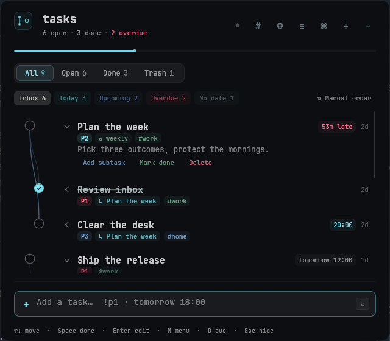
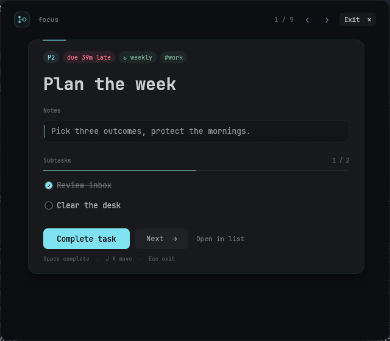
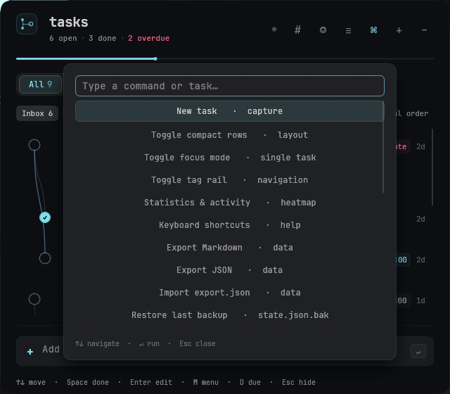
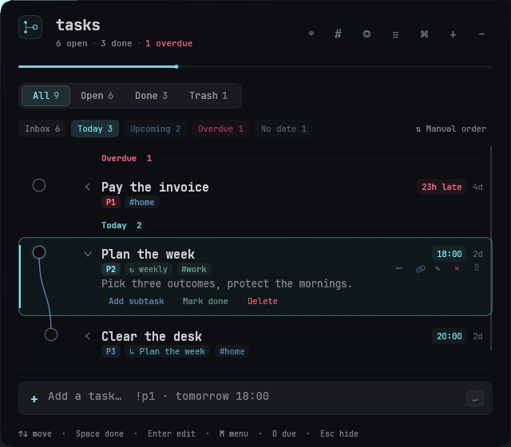
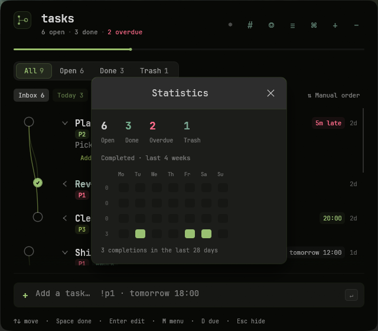

# tasks-rs

A native Linux task manager built with Rust and egui: a tree-shaped task list
with inline editing, tags, due dates, reminders, smart views, a focus mode and
a resident tray daemon.

[](LICENSE)
[](https://www.rust-lang.org)
[]()

<p align="center">
  
</p>

> Screenshots use demo data. The palette follows the current ColorEclipse
> palette automatically.

## Why this exists

Most task apps are either web wrappers or heavy Electron/QML shells. `tasks-rs`
is a small native binary with a resident tray daemon and a GUI that is only
alive while the window is open. State is a plain JSON file you can read, edit,
back up or sync however you like.

It is designed for a keyboard-first Linux desktop, but runs on any X11 or
Wayland session.

## Features

### Capture and organize

- nested tasks with a smooth, git-like graph; linking never moves the row;
- inline title and notes editing (double-click a title, or use the row menu);
- `#tags` parsed from titles and notes, with deterministic tag colors, a
  click-to-filter tag rail and `/ #tag` search;
- priorities P1–P3 and priority / due-date / manual sorting;
- drag-and-drop reordering with a row ghost, target highlight and edge
  auto-scroll;
- multi-select batch actions, a trash filter, undo/redo and an Undo button in
  destructive-action toasts.

### Views and focus

- smart views: Inbox, Today, Upcoming, Overdue and No date;
- grouped date sections with counts and collapsible headers;
- command palette on `Ctrl+K` for views, filters, actions, task jumps and data
  tools;
- compact row mode for small screens;
- a calm focus mode with a single task card, subtask progress and keyboard
  navigation.

### Time and recurrence

- due dates with a month calendar, time presets and natural-language input;
- custom reminder lead time (5 minutes, 1 hour, 1 day, or at the due time);
- recurring tasks (daily, weekly, monthly) that spawn their next occurrence when
  completed;
- quick capture syntax: `!p1`, `#tags`, and English or Russian dates such as
  `tomorrow 18:00`, `завтра 18:00`, `через 2 часа` or `пятница 10:00`;
- live parsed chips in the capture bar before you press Enter.

### Local data and desktop integration

- resident tray daemon with desktop notifications;
- atomic state writes and automatic `state.json.bak` backups;
- Markdown/JSON export, `export.json` import, restore from backup;
- a statistics window with a four-week completion heatmap;
- tray status, open/done/overdue counts and a systemd user service;
- reduced-motion mode;
- a theme that follows the current ColorEclipse palette.

| Focus mode | Command palette |
| --- | --- |
|  |  |

| Today view | Statistics |
| --- | --- |
|  |  |

## Requirements

- Linux (X11 or Wayland; Hyprland is supported for window positioning);
- Rust 1.85 or newer, with Cargo;
- common native build dependencies for eframe/winit:

  ```bash
  # Arch
  sudo pacman -S --needed base-devel pkgconf libxkbcommon wayland libx11 \
    libxcb libxrandr libxi mesa

  # Debian/Ubuntu
  sudo apt install build-essential pkg-config libxkbcommon-dev libwayland-dev \
    libx11-dev libxcb1-dev libxrandr-dev libxi-dev libgl1-mesa-dev \
    libegl1-mesa-dev libxcb-render0-dev libxcb-shape0-dev libxcb-xfixes0-dev \
    libfontconfig1-dev
  ```

- Optional: `notify-send` for desktop notifications.
- Optional: `JetBrainsMono Nerd Font` at
  `/usr/share/fonts/TTF/JetBrainsMonoNerdFont-Regular.ttf`; the app falls back
  to the default egui font if it is missing.

## Quick start

```bash
git clone https://github.com/your-name/tasks-rs.git
cd tasks-rs
cargo run --release -- --gui
```

The window opens at the top-right of the focused monitor. Closing it exits the
GUI process; the tray daemon keeps running.

## Install

The install script builds the release binary and installs the launcher, desktop
entry, icon and systemd user units under your home directory. It does not touch
the project source or any other application.

```bash
./install.sh
```

What it installs:

| Path | Purpose |
| --- | --- |
| `~/.local/bin/tasks-rs` | launcher / binary |
| `~/.local/share/applications/tasks-rs.desktop` | desktop entry |
| `~/.local/share/icons/hicolor/scalable/apps/tasks-rs.svg` | app and tray icon |
| `~/.config/systemd/user/tasks-rs.service` | resident tray daemon |
| `~/.config/systemd/user/tasks-rs-remind.{service,timer}` | reminder fallback |

If systemd is available the script enables and starts the daemon and reminder
timer. To do it manually:

```bash
systemctl --user daemon-reload
systemctl --user enable --now tasks-rs.service
systemctl --user enable --now tasks-rs-remind.timer
```

To update later, pull the repository and run `./install.sh` again, then restart
the service:

```bash
systemctl --user restart tasks-rs.service
```

## Optional Hyprland rule

The app works without a compositor rule, but a floating, pinned window gives
the intended behaviour. Example for a Lua-based Hyprland config:

```lua
hl.window_rule({
    match = { class = "^(tasks-rs)$" },
    float = true,
    size = "640 560",
    move = "40 40", -- adjust for your monitor layout
    pin = true,
    opacity = "1 override 1 override",
    no_blur = true,
    no_shadow = true,
    no_anim = true,
})

hl.bind("SUPER + T", hl.dsp.exec_cmd(os.getenv("HOME") .. "/.local/bin/tasks-rs toggle"))
```

For classic Hyprland config syntax, use the equivalent `windowrulev2` and
`bind` entries. Size and position are remembered in
`~/.local/share/tasks-rs/settings.json` when the compositor allows it.

## Commands

```bash
tasks-rs                 # toggle the window (default)
tasks-rs show            # show or spawn the GUI
tasks-rs hide            # close the GUI; daemon stays
tasks-rs add "buy milk #home"
tasks-rs status          # daemon / GUI / tray state
tasks-rs quit            # quit GUI and daemon
tasks-rs --gui           # GUI only
tasks-rs --daemon        # resident tray daemon
tasks-rs --remind        # one reminder pass (systemd timer fallback)
```

The daemon owns the tray, single-instance lock, reminders and process
lifecycle. Commands are line-based over Unix sockets in `$XDG_RUNTIME_DIR`.

## Keyboard

| Key | Action |
| --- | --- |
| `Ctrl+K` | command palette |
| `↑` / `↓`, `j` / `k` | move selection |
| `Space` | complete / reopen |
| `Enter` | edit title inline |
| `M` | row actions menu |
| `D` | due date |
| `1…5` | Inbox / Today / Upcoming / Overdue / No date |
| `Alt+1…5` | same, while a text field is focused |
| `/` | search |
| `Ctrl+1…4` | All / Open / Done / Trash |
| `Ctrl+A` | select all visible |
| `Ctrl+Z` / `Ctrl+Shift+Z` | undo / redo |
| `Esc` | close popup, cancel edit, exit focus or hide |

## Data and safety

- `~/.local/share/tasks-rs/state.json` — tasks. The v2 schema accepts the
  optional fields `priority`, `repeat`, `remind_lead` and `completed_at`.
- `~/.local/share/tasks-rs/settings.json` — window geometry, `compact`, `sort`
  and `reduce_motion`.
- Writes are debounced, atomic (`state.json.tmp` + rename) and keep a
  `state.json.bak`.
- If `state.json` cannot be parsed, the app shows an error banner, disables
  editing and **never overwrites it with defaults**.
- Dangling parents, self-parents and cycles are pruned on load; deleting a
  parent removes its subtree.
- Override the state path for testing with `TASKS_RS_STATE=/path/to/state.json`.

Export and data tools live in the command palette (`Ctrl+K`):

- Export Markdown;
- Export JSON;
- Import `export.json`;
- Restore `state.json.bak`;
- Open data folder.

There is no cloud sync, account or telemetry. The app is local-first.

## Architecture

```
systemd --user  tasks-rs.service
        │
        └── tasks-rs --daemon                 small resident process
              ├── StatusNotifierItem tray       (ksni)
              ├── $XDG_RUNTIME_DIR/tasks-rs.sock  CLI / single instance
              ├── reminders (every 10 s, notify-send)
              └── spawns  tasks-rs --gui  on Show/Toggle/Add
                            │
                            ├── $XDG_RUNTIME_DIR/tasks-rs-gui.sock
                            └── renders ~/.local/share/tasks-rs/state.json
```

On Wayland, hiding a window is not reliably honoured by every compositor, so
closing the window exits the GUI process while the daemon and tray stay
resident. The next Show/Toggle starts a fresh GUI and restores its size and
position.

## Performance

The daemon is intentionally small (a few MB of resident memory) and idle at
essentially 0 % CPU. The GUI is heavier because egui/eframe keeps GPU and
Wayland/X11 file-backed mappings; most of its RSS is shared driver memory, not
task data.

## Build and test

```bash
cargo build --release
cargo test
```

39 unit tests cover hashtag parsing, fuzzy search, graph pruning, atomic
saves/backups, unreadable-state handling, calendar grids, Russian and English
date parsing, recurrence helpers, Markdown export and activity buckets.

The CI workflow builds and tests on Ubuntu with the native eframe dependencies.

## License

MIT — see [LICENSE](LICENSE).
